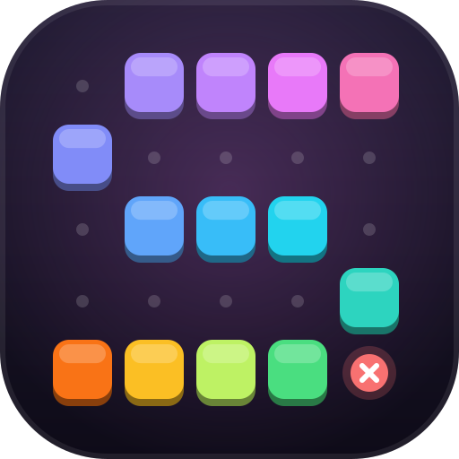

<p align="center">
  
</p>

<h1 align="center">SpillArena</h1>

<p align="center"><strong>Your next game starts here.</strong><br />
A browser arcade for quick challenges, friendly competition, and one shared player profile.</p>

<p align="center">
  <a href="https://spillarena.no">Play now</a> ·
  <a href="https://spillarena.no/#faq">FAQ</a> ·
  <a href="https://spillarena.no/#contact">Contact</a> ·
  <a href="docs/OPERATIONS.md">Developer docs</a>
</p>

<p align="center">
  
  
  
  
</p>

## Step into the arena

SpillArena brings independent web games together in a responsive lobby. Browse by category, search for a favourite, or let the game picker choose your next challenge. Play as a guest, or sign in to keep supported game progress and scores connected to one account.

- **Find your game.** Category filters, search, bilingual posters, and a spotlight based on recent game-page visits.
- **Make it yours.** Shared profiles, XP and levels from saved game progress, and optional DiceBear pictures with a first-letter default.
- **Play comfortably.** Norwegian and English, light and dark themes, responsive layouts, and storage controls.
- **Stay informed.** Clear beta prompts, a changelog, FAQ suggestions in the contact form, and account recovery.
- **Run the arena.** An authenticated admin panel for players, saved progress, moderation, messages, audit history, and traffic per game.

## Pick a challenge

| Game | The challenge |
| --- | --- |
| [FleetBot](https://github.com/SpillArena/FleetBot) | Battleship strategy and friendly naval duels |
| [HangBot](https://github.com/SpillArena/HangBot) | Guess the word before the drawing is complete |
| [ScribbleBot](https://github.com/SpillArena/ScribbleBot) | Recognise drawings as they come to life |
| [AtlasMaster](https://github.com/SpillArena/AtlasMaster) | Explore geography and test your map knowledge |
| [ProportionPanic](https://github.com/SpillArena/ProportionPanic) | Judge proportions and sharpen your estimation skills |
| [PixelPanic](https://github.com/SpillArena/PixelPanic) | Identify pictures through their pixels |
| [EraShuffle](https://github.com/SpillArena/EraShuffle) | Put historical events in chronological order |
| [MelodyRush](https://github.com/SpillArena/MelodyRush) | Recognise music from short previews |
| [Hitline](https://github.com/SpillArena/Hitline) | Place songs on a musical timeline |

Game availability and beta status are maintained in [`src/data/games.ts`](src/data/games.ts). Each game has its own repository; this one owns the lobby and shared account service.

## Run locally

Use Node.js 22.12+ and npm.

```bash
npm ci
npm run dev
```

Vite serves the frontend. Accounts, contact messages, and analytics need Cloudflare Pages Functions, a local D1 database, and an ignored `.dev.vars` file. Follow the [operations guide](docs/OPERATIONS.md) for full-stack setup and production configuration. Keep credentials out of `VITE_` variables and Git.

## Check a change

```bash
npm run lint
npm run test:admin
npm run test:avatar
npm run test:popularity
npm run test:contact
npm run build
```

`npm run preview` serves the production frontend build. `npm run art` regenerates the shared game artwork.

## Built with

React · TypeScript · Vite · Tailwind CSS · Framer Motion · i18next · Lucide · DiceBear · Cloudflare Pages Functions · D1

```text
src/          Lobby, profiles, admin UI, translations, and game artwork
functions/    Account, progress, contact, and analytics API routes
shared/       Server authentication, game registry, and analytics helpers
migrations/   Shared account and leaderboard database schema
tests/        API and analytics regression checks
scripts/      Artwork generation and maintenance tools
docs/         Architecture, operations, branding, and design notes
```

## Architecture and documentation

Games are routed under `spillarena.no/<game>` and share the same origin. The hub issues signed sessions and owns the account APIs; games keep their own gameplay and interfaces. The admin panel checks the current account permissions on every request. Analytics are supplied by Cloudflare without an added browser beacon.

- [Account architecture, analytics, and deployment](docs/OPERATIONS.md)
- [Shared shell and branding](docs/SITE_SHELL.md)
- [Lobby and account design](docs/design/IMPLEMENTATION.md)
- [Avatar credits and licences](docs/AVATAR_CREDITS.md)
- [GitHub About text and topics](docs/GITHUB_ABOUT.md)

## Contributing

Create a branch from `development`, keep changes focused, and run the checks above. Include screenshots for visible UI changes and document any migrations or configuration requirements in your pull request.

---

Created and maintained by [Emil Berglund](https://github.com/EmilB04) · [emilb.no](https://emilb.no)
